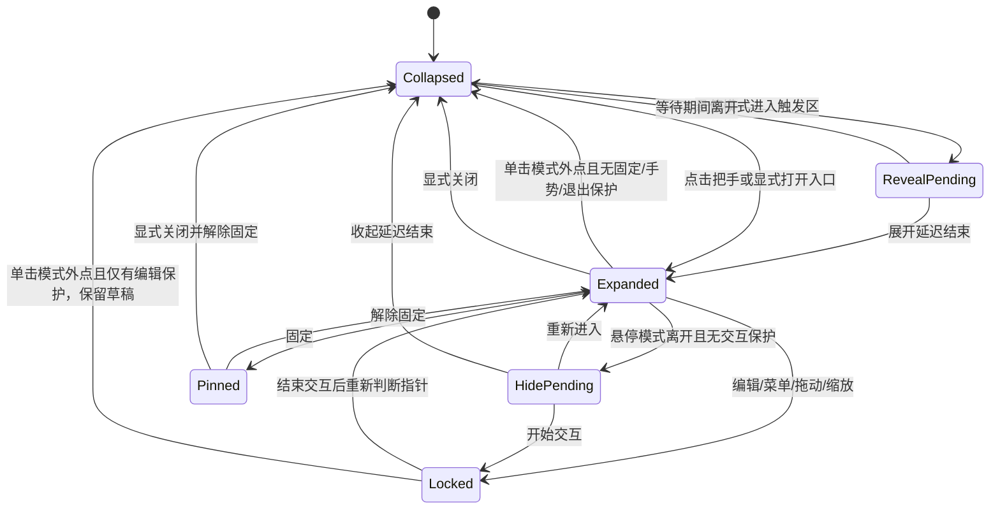

# 交互设计：控制台与边缘小窗

## Android 补充（2026-10-13）

手机使用单窗口，底部导航为今日、全部、截止、设置；已完成与回收站位于设置。列表保持任务标题、完成状态、优先级和截止信息层级，触摸目标至少44px。上方＋新建，点击任务打开模态编辑；关闭或系统返回保留未保存草稿，重开可继续，显式放弃才清除。任务revision变更保留草稿并提示重新核对，不能静默覆盖云端新内容。移出今日只改计划，回收站恢复保留任务身份和截止信息。

手机与桌面登录同一Supabase项目/账号，复用首次明确合并、逐项冲突选择和断开语义。前台及恢复联网后补传，后台暂停轮询，第一版不承诺后台即时同步。Android没有桌面托盘/边缘小窗控制；浅深色和四风格各机独立。平台与安全取舍见[ADR-0010](../decisions/0010-android-and-three-device-sync.md)，以下为既有桌面交互契约。

状态：交互契约，包含回收站、草稿保护与可选双端同步。同步入口已在开发源码实现，实际 Supabase 项目与 Mac ↔ Windows 联网验收待完成，旧下载包不含此入口。产品行为以 [PRD](PRD.md) 为准。

## 大窗口控制台

主界面用于集中管理，采用正常可调整大小的系统窗口。以下是信息布局草案，不是最终视觉样式：

```text
┌──────────────────────────────────────────────────────────────┐
│ 侧笺 SideTask                                    ＋ 新建任务 │
├────────────┬──────────────────────────┬──────────────────────┤
│ 今日       │ 全部任务       排序 ▾   │ 任务详情             │
│ 全部任务   │                          │ 标题：提交课程作业   │
│ 截止日期   │ □ 提交课程作业   高     │ 截止：9月30日        │
│ 已完成     │   9月30日 · 已在今日     │ 重要程度：高         │
│            │ □ 交实验报告     普通   │ 备注：……             │
│            │   10月5日 · 加入今日     │                      │
│            │                          │ 已安排今日 ✓         │
│ 回收站     │                          │ 保存    标记完成     │
│ 设置       │                          │                      │
└────────────┴──────────────────────────┴──────────────────────┘
```

「今日」「全部任务」「截止日期」「已完成」「回收站」都是同一批大任务的不同视图。点击一条正常任务在详情栏编辑；回收站详情只读，先恢复再编辑。窄窗口改为任务详情页/抽屉，保证标题、DDL 和保存动作可见。第一版没有项目树、子任务按钮、任务内勾选清单、甘特图或百分比进度。

今日计划、全部任务和截止日期的未完成行均有独立排序把手；按住把手拖到目标插入线后松手保存。任务名称仍用于查看详情，勾选仍用于完成，不把文字选择或普通点击当成排序。三份列表各存各的顺序，今日和截止日期在大小窗同步；拖动不修改 DDL、完成状态或任务内容。

DDL 的下拉菜单提供“按截止日期”“按重要程度”“手动排序”。日期/重要程度模式也能直接拖动，成功后在同一事务切为手动；切回自动排序保留上次手动顺序。手动模式保留逾期/日期标签，不能用分组重新打乱已保存次序。聚焦把手后可用 `Alt+↑/↓` 移动，边界处不提交；拖动时按 `Esc` 取消。控制台今日列表继续保留“上移”“下移”“移出今日”。

拖动过程只显示插入线，不逐帧写入或预先交换已提交任务；靠近列表上下边缘可滚动，松手在当前列表内部才提交一次。拖回原位、列表外松手、失去捕获/焦点或 `Esc` 取消均不保存。保存中禁用重复排序；失败显示原因并保留已提交顺序，成功后焦点回到移动后的任务把手。跨窗更新、跨天、切页或切换排序方式使旧手势失效，不能用旧顺序覆盖新状态。

搜索筛选时不提供局部排序，清空搜索后可整理完整列表；已完成、此前未完成与回收站列表没有拖动入口。移出今日只取消当天安排，可从全部任务或此前未完成重新加入，不影响 DDL。今日已完成/回收站任务的计划字段、历史日期不参与重排；全部任务与 DDL 已记录的隐藏任务保留排序槽位，恢复后继续参与相同顺序。

页面保持任务优先的左对齐布局。标题只说明当前视图；今日日期保留，待办 / 完成数放在列表标题行，不用独立完成圆环或统计卡。侧栏保留导航、设置与普通“打开小窗”入口，移除宣传卡和重复存储状态。霜序使用连续分组列表，暖刊仅在页面主标题保留宋体，其余任务和控件采用系统字体。四套可切换风格和任务行为继续保留；本轮修改减少视觉层级，不减少任务能力。

设置分组：

- **界面风格**：设置页首屏展示纸笺、霜序、暖刊、极简四张缩略卡。每张包含控制台和小窗示意、名称、特点与选中勾标。点击后仅提交 `uiStyle`，成功才切换并通知其他窗口；写入失败保留原外观。切换时保留设置页位置和未保存的其他设置草稿，不重新创建窗口、不改变任务。浅深色/跟随系统仍为独立偏好。

- **边缘小窗**：启用/暂停、当前停靠显示器、左/右边缘、沿边位置、宽高、展开方式（默认「单击展开」、可选「悬停展开」）、固定展开/置顶选项。只有选择悬停模式时显示展开/收起延迟；位置也能直接拖动调整。
- **外观**：浅色 / 深色 / 跟随系统用三个紧凑按钮选择，选中状态明确，不重复展示三张页面缩略图。明暗偏好与四套界面风格独立，仍随设置草稿保存。
- **Mac 与 Windows 同步**：可选项目配置和账号登录、最近同步、待上传、重试、冲突选择与断开；任务和计划参与同步，窗口与外观只在本机应用。
- **通用**：快捷键、开机启动；额外快捷键/自启属于建议能力。
- **数据与关于**：存储状态、版本、完整任务备份的导出与恢复；整份备份恢复与单项回收站恢复分开呈现，不混入普通任务详情。

边缘小窗设置在用户点击应用且保存成功后更新。验证失败保留旧设置并给出错误；发生系统应用失败时展示实际生效值与重试入口，不能显示未生效的成功状态。更改显示器/位置时安全收起并重定位。控制台普通窗口尺寸与小窗尺寸分别保存。

## 可选同步设置

同步区域位于控制台设置内，不新开常驻窗口，不在小窗加入账号表单。浏览器预览明确显示“云同步仅在桌面版使用”，没有真实登录请求。接入步骤见 [Supabase 配置说明](../engineering/SUPABASE_SETUP.md)。

未连接时依次填写项目地址、公开连接 Key、邮箱和密码，明确勾选“将本机任务与此账号合并”后点击“登录并启用同步”。表单先检查托管 HTTPS 项目地址与公开 key；不能把 secret/service_role key 当客户端配置。连接中防重复提交，失败保留非密码配置并清空密码。配置草稿参与离页保护；密码仅在当前输入内存中，普通“保存设置”或“保存并离开”不得隐式连接、上传或保存密码。同步字段也不能阻挡未启用同步用户保存无关窗口设置。

已连接时显示账号、项目、最近完成同步的时间，以及正在同步、待上传或错误状态；“立即同步”/“重试同步”只发出明确同步意图。状态事件刷新不能以旧响应盖住新状态，订阅失败应提示并可恢复订阅。后台同步不抢焦点，不清除任务编辑草稿；远端已提交变化仍经过现有任务版本保护。

冲突区逐项呈现本机与云端的简短内容，提供“保留本机”/“保留云端”两个选择且不预选。全部选好才启用“确认解决全部冲突”；冲突内容变化后清除旧选择，重新核对。未解决时禁用普通同步提交，不能用“重试”绕过选择。四套风格沿用已有文字和控件，窄窗口纵向排列，能滚动到最后一项且不被固定保存栏遮挡。

凭据过期显示重新登录入口，保留原项目和邮箱；更换账号先断开。断开须明确说明“保留本机任务，云端数据也不会删除”，未上传时提醒可先继续同步；凭据清理失败时自动同步已停止但绑定保留，继续提供“重试断开”和原账号重登入口。整份备份恢复前要求完成断开，即使凭据已失效也不得悄悄导入并覆盖云端。

## 控制台窗口偏好与失败反馈

主动启动恢复普通客户区尺寸、工作区相对位置和最大化偏好；不把上次隐藏、最小化或全屏当作下次不可见启动的指令。恢复与校准本身不抢焦点，只有启动、托盘或明确管理任务动作才显示/聚焦。普通大窗保留跨屏自由，位置无法操作时才校准；小工作区下仍可滚动到新建、详情和设置保存。

位置写入失败在工具栏下方显示“本次窗口位置未保存”和原因，提供“重试保存位置”“不保存本次位置”。重试保存点击时的实际位置；丢弃本次候选，不把窗口弹回旧位置，下次移动仍可保存。失败恢复不能重置任务、表单、搜索或导航；操作中只冻结这两个按钮，任务编辑继续可用。用户主动移走键盘焦点时不能抢回来；失败按钮重新启用后仍可用键盘重试。

关闭控制台仍隐藏并常驻；退出草稿门禁不变。位置保存失败不能让明确退出陷入循环。首次恢复失败时保留旧偏好，显示错误及恢复入口，不把部分位置/尺寸成功当完整保存。

## 回收站与任务恢复

回收站位于控制台侧栏底部，显示数量，沿用当前风格、列表密度和键盘操作。列表按移入时间倒序，同时间保持稳定次序；行内显示标题、原完成状态、DDL、移入时间和“恢复”。正常搜索包含未删除的未完成/已完成任务；进入回收站后搜索框改为“搜索回收站”，只在回收站内查标题和备注。今日、此前未完成、DDL、已完成及其数字都不包含回收站任务。

详情底部的“移入回收站”与“移出今日”“标记完成”分开。有草稿时显示“移入回收站前保留修改？”，提供三个明确选择：

| 操作 | 行为 |
| --- | --- |
| 继续编辑 | 关闭确认，保留原输入与焦点，不写入数据。 |
| 保存后移入 | 先保存草稿，再基于本次保存成功的版本移入。保存失败保留草稿；保存成功但移入失败时分别说明两个结果，任务仍可见。 |
| 放弃修改并移入 | 明确放弃未保存内容，只将已提交的任务移入；失败时任务和草稿仍保留。 |

无草稿时直接提交。成功后显示“已移入回收站”与“恢复”，任务从日常列表和小窗同步移除；键盘焦点移交相邻任务或列表。失败保留原界面并显示原因，不提前移除任务。恢复可以来自行内、详情或提示，均保留原 Task ID、DDL、完成时间和全部计划；原来已完成的任务仍已完成。跨天恢复不自动加入今天，原计划照既有规则显示。

恢复后提供“查看任务”，未完成任务定位“全部任务”，已完成任务定位“已完成”并打开详情；显式查看时将键盘焦点交给详情标题。提示中的导航也必须使用点击时最新的草稿状态，出现保存/放弃/继续编辑门禁时等待用户处理，不因提示到期跳过保护。后台更新不移动焦点或激活窗口。

另一个窗口删除正在编辑的任务时，保留原详情和输入，显示“任务已在另一处移入回收站，草稿仍保留”。表单暂为只读，恢复后通过现有冲突确认继续保存。行内恢复、详情恢复和提示恢复都不能因为条目从回收站消失而卸载仍有草稿的详情；恢复标记与离开编辑是两件独立的事。过期的“恢复”提示不能撤销后续一次新的删除。

空状态写“回收站为空”，说明任务会保留、可随时恢复；不出现自动清理倒计时或永久删除/清空入口。小窗继续用于日常任务，只通过完整编辑入口进入控制台管理回收站。

## 边缘小窗展开后的结构

```text
┌─────────────────────────────┐
│ 侧笺                 固定  × │
│ 9月24日 周四                │
│ 今日计划 ＋             2/5 │
│ □ 英语阅读 30 分钟          │
│ □ 提交课程作业  高  明天截止│
│ ▸ 此前未完成（2）           │
│ ▸ 已完成（2）               │
├──────── 可拖动分隔条 ───────┤
│ 截止日期          日期 ▾    │
│ □ 提交课程作业    明天      │
│   高 · 已在今日             │
│ □ 交实验报告      9月30日   │
│   普通        ＋ 加入今日   │
│ ▸ 已完成                   │
├─────────────────────────────┤
│ 管理任务              设置 │
└─────────────────────────────┘
```

上下区域独立滚动，标题和底部工具保留；可调整分隔条。缩到较小时仍保留两个区的标题与基本操作，不把 DDL 区挤到完全不可见。小窗任务标题最多显示两行，鼠标悬停可看全文，点击进入控制台详情查看完整内容；读屏名称保留全文。DDL 和勾选控件不被长标题挤掉。控制台正文仍可完整换行。

小窗顶部只显示紧凑日期，不显示口号或装饰太阳；各尺寸一致地把空间优先留给任务。最小尺寸须至少让两个分区的首项摘要、勾选及日期信息完整可见。

小窗“今日计划”标题旁常设“＋”，底部“＋”打开同一处行内快速输入，不打开控制台。输入名称后按回车或点击“添加”，通过共享任务服务一次创建任务并加入保存时的本地今日，默认普通重要程度、无 DDL；成功后清空并保留输入焦点，支持连续添加。完整备注、DDL 与重要程度仍在控制台编辑。点击已有任务打开控制台并定位当前 Task。小窗中的 DDL 任务与今日任务不是两份记录，控制台也没有额外副本。

快速输入期间暂停悬停模式的离开收起；中文组合输入及 WebKit 的 229 回车只确认输入法，不提交。空白/超长名称有明确提示，保存失败保留草稿，保存中冻结输入并拦截重复提交。收起输入区或从小窗跳到控制台前，有草稿时提供保存、放弃、继续编辑；显式隐藏整个小窗只隐藏视图，重新展开仍保留草稿。输入区处于今日滚动区内，最小尺寸仍保留今日/DDL标题和底部操作。

明确退出时先处理小窗草稿，再处理控制台草稿；任意一步取消都恢复编辑，失败不能批准退出。小窗完成确认后等待控制台期间冻结编辑，避免确认后产生未经处理的新草稿；已暂停或隐藏的小窗有草稿时，退出确认临时显示小窗，不修改暂停偏好。系统强杀/关机不承诺保存未提交草稿。

小窗今日未完成行可直接“移出今日”，今日与 DDL 都可通过行内把手拖动或 `Alt+↑/↓` 排序，不必打开控制台。两区各自排序且只在各自列表内部落下；拖动和保存期间持有独立交互保护，结束后释放，不因鼠标离开收起小窗。同一列表使用大小窗共享的已提交顺序，不增加小窗专属排序。

## 文案与反馈

界面文字用于解释状态或下一步动作。新建表单使用“新建任务”等直接标题；空状态区分今日尚未安排、没有截止任务、没有搜索结果；完成后显示结果并保留“撤销”。删除励志口号、装饰性说明和重复宣传，保留日期、优先级、冲突、失败与恢复所需的信息。修改视觉风格不能隐藏错误或把未保存状态说成已保存。

## 拖动小窗与停靠

沿屏幕边缘移动是明确需求。换边、主动换屏、吸附细节是目前的交互方案：

1. 收起时按住把手拖动，展开时按住标题空白区拖动。设置拖动阈值，点击和小幅晃动不误触发迁移；任务文字选择、列表滚动及尺寸手柄不当成拖窗。
2. 拖动期间暂停悬停/离开计时，取消旧计时回调，不自动收起。小窗可沿边移动，也可随用户主动拖动经过两屏接缝；收起状态只移动把手，不突然展开完整任务面板。
3. 释放在可用屏幕内时，选择该屏幕最近的合法左/右停靠边，拖动时可预览候选位置；松手后重新校准尺寸和缩放再停靠。接缝用平台返回的指针所属屏幕，结果不唯一时取最近一次有效候选；无有效候选则取消，避免来回跳动。
4. 释放在无效位置或收到原生拖动取消事件时返回此前的合法停靠位置；旧屏幕已断开时回退到可用屏幕。平台能在拖动会话接收 Esc 时，将它优先作为取消拖动处理；不能假定未获焦把手的 WebView 收得到 Esc，此项由双平台 POC 验证。恢复原有固定展开/收起状态，不丢任务草稿。
5. 停靠完成后一次保存新位置，避免每个移动事件都写数据库。保存失败提示并恢复最近已提交的合法位置；若控制台已提交新位置，应停止旧拖动并应用新配置，不能用旧快照覆盖。重新允许悬停前要求指针先离开触发区。

「固定」只表示持续展开，仍可移动和缩放。防止邻屏溢出从停靠完成后生效，尤其针对展开/收起动画；用户主动拖动跨屏不视为动画泄漏。拖动捕获、取消及跨 DPI 行为需要双平台 POC 验证。

## 两种窗口如何配合

| 操作 | 预期行为 |
| --- | --- |
| 小窗点管理任务 | 打开/唤醒唯一控制台，默认进入今日 |
| 小窗点设置 | 唤醒同一控制台并切到设置页 |
| 小窗点完整编辑 | 控制台按 Task ID 定位详情，先处理其他未保存编辑 |
| 托盘/菜单栏打开控制台 | 即使边缘入口被暂停，也能恢复管理界面 |
| 关闭大窗口 | 先处理未保存编辑，然后隐藏/关闭大窗；边缘功能继续运行 |
| 最小化大窗口 | 按系统习惯最小化，可再次打开；不会退出整个应用 |
| 明确退出 SideTask | 处理未保存修改，结束所有窗口、把手与后台服务 |
| 重复启动应用 | 复用已有进程和控制台；不生成第二个数据库写入者 |
| 控制台正在前台使用 | 暂停非固定小窗的悬停呼出；单击模式外点可收起但保留快速输入草稿 |
| 小窗已固定 | 保留查看和勾选；完整编辑仍在控制台，不强行切焦点 |

两处同时编辑同一任务时，不用最后一次保存静默覆盖。遇到版本冲突，保留输入草稿，提示刷新最新任务后再提交。只是在一处完成/撤销任务时，另一处普通列表直接更新。

主动打开控制台可以激活应用；无意识经过屏幕边缘不应弹出控制台。用户从小窗进入控制台前若有未保存快速输入，先保存/取消，避免窗口切换造成丢失。常驻去向在首次打开控制台的内联说明中解释；关闭后不向已隐藏的窗口发送看不见的提示。

Windows 托盘左键抬起恢复同一控制台，右键保留打开、设置与退出菜单；使用应用彩色图标适配浅深任务栏。关闭控制台仍保持后台运行，退出仍走未保存草稿门禁。该入口实现与真实托盘点击验收分别记录。

## 出现与消失

1. 默认“单击展开”：折叠时只显示小把手，单击展开；路过和鼠标离开都不改变显示。点击小窗外部（包括其他应用或控制台）收起，同时让原点击正常执行。右键或其他鼠标键同样属于外部点击。
2. 设置可选择“悬停展开”：进入把手并停留后展开，鼠标经过把手和面板算作同一交互区；离开后开始收起计时，返回取消。只有选择此模式时显示展开/收起延迟。
3. 模式和延迟使用“保存设置”提交；切换模式不清任务、草稿或既有延迟值。旧偏好缺字段默认单击，保存后跨窗同步并在重启保留；切模式取消旧计时。
4. “保持展开”在两种模式均暂停自动收起，不锁位置。显式关闭仍可收起并解除固定；悬停模式显式关闭后须先离开触发区，避免立即弹回。
5. 单击模式的外部点击可隐藏快速输入，重新展开仍可继续编辑；隐藏不代表取消/清空。正在拖动、缩放或处理退出确认时不因外点收起。
6. 把手、控制台和菜单栏/托盘保留显式打开入口。

## 焦点与操作保护

悬停只是看：不自动把当前编辑器、浏览器或终端的键盘焦点切走。单击或明确输入意图允许小窗进入可编辑状态，外部点击继续在目标应用正常执行。仅切换键盘焦点不是外部点击。Mac 与 Windows 均通过真实鼠标事件执行；外点可隐藏输入但保留草稿，重开可继续添加。实现见[ADR-0007](../decisions/0007-panel-reveal-mode.md)，单屏原生样本不代表完整多屏与两平台矩阵通过。

悬停模式在编辑、中文输入法组合、日期/优先级菜单、选择文字、拖动把手、缩放窗口期间暂停离开收起。保存/取消后释放保护，再按鼠标位置判断。单击模式外部点击仅隐藏快速输入，不清草稿；主动取消输入或退出仍给出保存/放弃/继续编辑。

`Esc` 优先关闭子菜单，其次取消编辑，最后关闭面板；IME 组合中的 Esc 交给输入法。悬停状态下键盘焦点仍在原应用，因此 Esc 只在面板已获得键盘焦点时处理；显式收起按钮是已实现的关闭入口。

点击勾选后保留短暂反馈再放入已完成折叠区，提供撤销，避免列表移动导致连续误点。操作失败恢复原状态并展示明确错误。

## 状态机



图为交互概览；实际实现中「固定」与「交互保护计数」应是正交字段，避免固定状态编辑后丢失固定设置。显示器变化、睡眠、退出等系统事件可以中止计时；编辑数据独立保存，不能因窗口重建丢失。

## 首次使用

首次打开正常控制台，显示简短内联说明：关闭大窗后仍在菜单栏或系统托盘运行，可从那里重新打开控制台或明确退出。提供“打开边缘小窗”“知道了”，使用默认停靠即可开始，不强制选屏、示例任务或逐步向导；不自动展开小窗、不移动焦点。暂停边缘入口时说明可在设置开启，不替用户更改开关。

确认状态独立于任务数量，只有保存成功才隐藏，失败保留说明并可重试；不卸载任务或设置草稿。设置页始终保留使用说明。已有任务或仅有回收站记录的升级用户同样按独立标记判断，损坏启动恢复页不显示此说明。用户主动再次启动应用打开控制台；登录自启仍为待排建议能力，若实施只恢复常驻入口，避免打断学习。只在用户启用需要权限的能力时解释并申请对应权限。

## 可访问性与干扰控制

- 鼠标和键盘都能新建、完成、排序、关闭；焦点顺序明确。
- 重要程度和逾期不能只靠颜色，配合文字及读屏标签。
- 遵循系统浅色/深色和减少动态效果偏好；不闪烁、不自动播放声音。
- 触发区不覆盖系统 Dock/任务栏等主要操作区；可调位置和等待时间。
- 输入菜单和弹层也要限制在目标屏幕可用区域内，优先在面板内部展示。

边缘小窗停靠后，所有可见部分留在当前停靠屏幕内；主动拖动可跨屏，结束后重新吸附并应用防溢出规则。控制台可以像普通窗口一样跨屏移动。恢复控制台时不能落在已断开的显示器之外。

## 本轮数据与退出交互

原生首次使用为空任务库，空状态说明新建、小窗与菜单栏/托盘恢复入口。设置的数据备份区导出到应用自管目录，显示可复制路径；导出包含回收站、全部计划和三份列表的顺序。导入先选 JSON 并验证，再显示总任务、其中回收站、计划数量与导出时间。说明确认恢复将替换当前任务、回收站及顺序，并保留当前设备设置（包括 DDL 排序模式）；先备份当前库再替换，不能暗示只会合并或恢复某项任务。旧版备份按其原有任务集合恢复，未保存的全部任务/DDL 手动顺序使用默认顺序。未保存草稿或在途写入时不能开始整份备份恢复；预览后任务改变须重新预览。

新建任务取消/Esc先保留或放弃草稿；详情、设置及新任务共同参与显式退出的保存/放弃/取消。保存期间冻结表单和导航，避免后续输入被完成回调覆盖。多层弹窗只由最上层处理Escape。设置已保存但系统应用失败时给出原因和重试；不以数据库提交冒充窗口同步。

## 已采用的分区比例交互

小窗今日/DDL分隔线可拖动，比例30–70%，默认54%；方向键每次5%，Home/End到边界。指针松手、键盘keyup或离开分隔线时保存一次，手势中只预览；取消或丢失捕获回到已保存值。保存期间禁止重复调整并暂停自动收起。失败保留所见比例，提供“重试保存”和“恢复已保存比例”；其他窗口修改同一比例时明确提示冲突，只有“使用此比例”才提交当前调整，其他设置保留。恢复或保存成功后，若原操作按钮消失且用户没有主动移焦，键盘焦点回到分隔线。

比例按当前两个内容区布局，不改变原生窗口尺寸、位置或显隐。分隔线提示说明拖动与键盘操作，四套明暗沿用原风格；最小窗口保留两区标题、恢复操作与底部管理入口。原生与双平台的覆盖范围须依据实际设备验证，不以浏览器的命令记录代替。

## 小窗尺寸的保存与取消

拖尺寸握柄时以当前实际外框作预览；松手保存一次，单击未移动或拖回起点不保存。只调宽度时保留原高度偏好，只调高度时保留原宽度偏好。工作区暂时太小只限制实际窗口，不把被限制的另一轴自动写回偏好。

方向键按每步10逻辑像素累积，松键后保存；保存期间握柄标示忙碌并暂不接受新一轮调整，完成后可继续。Esc、指针取消、捕获丢失或窗口失焦取消尚未提交的调整。外部设置或目标屏幕/DPI改变会结束本次缩放并恢复最新保存设置，旧操作不能继续覆盖。

预览不逐帧写库。提交失败恢复原停靠位置和最新保存尺寸，错误保持可见；分区拖动与尺寸调整各自持有交互保护，结束其中一个不会解除另一个。普通窗口位置记忆、任务编辑和数据备份继续按各自流程工作。这里描述交互契约，真实键盘焦点、跨屏和系统取消是否通过仍分别记录原生验收。
